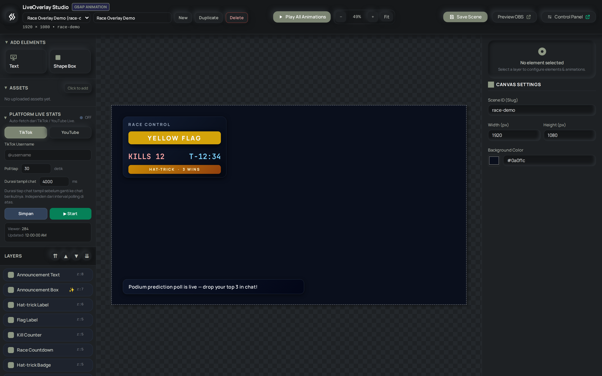
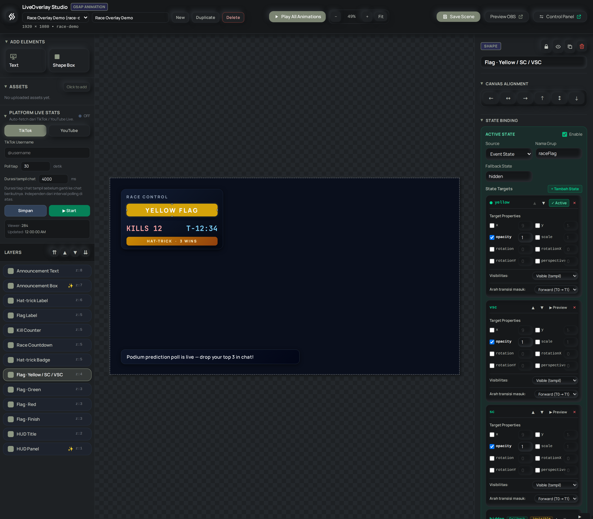
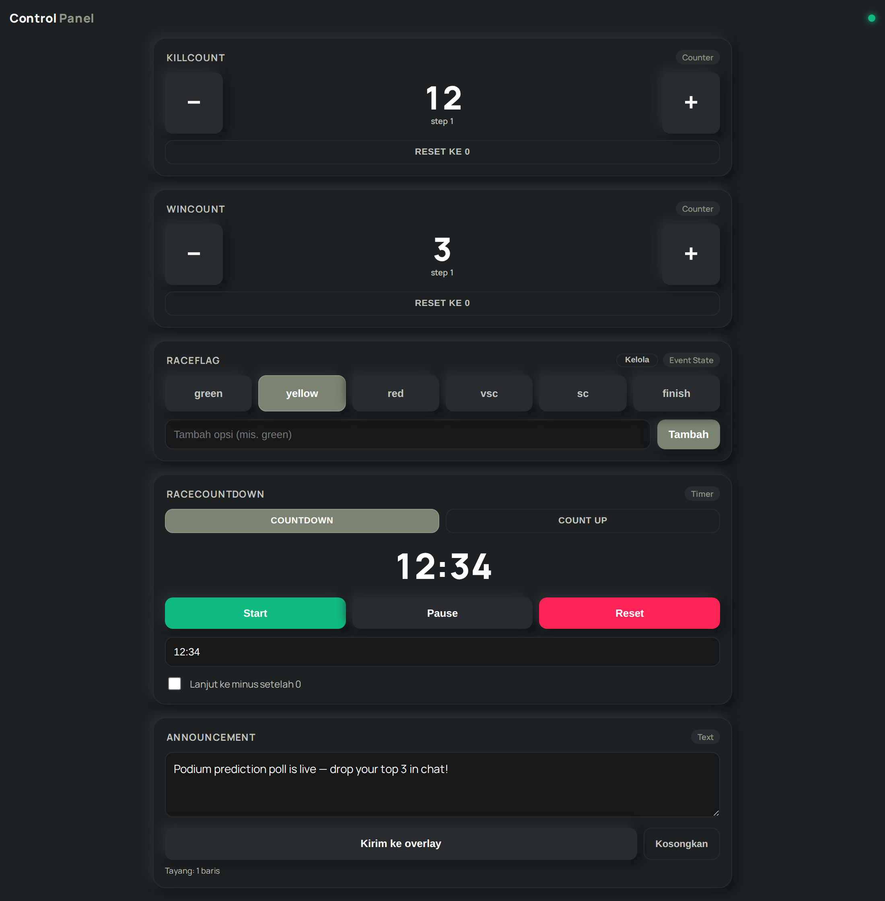

# 🎬 LiveOverlay Studio

**Versi: v1.1.0** · lihat [`CHANGELOG.md`](./CHANGELOG.md) untuk riwayat lengkap pengembangan.

**LiveOverlay Studio** adalah editor kanvas visual (mirip Canva/Figma versi ringan) untuk merancang overlay live streaming, ditenagai oleh **Bun**, **ElysiaJS**, **Tailwind CSS**, dan animasi **GSAP**.

Didesain khusus untuk live streamer (TikTok Live, YouTube, Twitch) yang ingin **menyusun sendiri komposisi visual overlay-nya** dari GUI — bukan sekadar isi form teks — lalu menampilkannya secara real-time sebagai OBS Browser Source, lengkap dengan animasi, aset custom (SVG/gambar), dan multi-scene untuk berbagai output sekaligus.

Prinsip utama: **WYSIWYG — What You See Is What You Stream**. Apa yang disusun di kanvas editor, itu juga persis yang tampil di overlay saat live.

---

## 📸 Screenshots

> Diambil dari scene demo (bukan data asli).

### Editor


### State Binding
Inspector elemen: bind ke Event State atau Counter, atur target visual per state, visibilitas, dan arah transisi.



### Control Panel
Halaman `/control` untuk mengubah Counter, Event State, Timer, dan Text secara live.



---

## ✨ Fitur Utama

- 🎨 **Canvas Editor Visual**: Drag & drop elemen langsung di kanvas — bukan lagi form statis. Mirip artboard di Illustrator/Figma, lengkap dengan panel Layers.
- 🧱 **Sistem Elemen & Layers**: Tambah elemen Text, Shape, dan Image/SVG. Setiap elemen bisa di-reorder (z-index), diduplikasi, disembunyikan, atau dihapus.
- 🎛️ **Panel Properti Lengkap**: Atur transform (posisi, ukuran, rotasi), style (warna, opacity, border, font), dan animasi per elemen langsung dari sidebar.
- 🌀 **State Binding & Animation Sequence per Elemen**: Bind elemen ke Event State atau Counter, atur target visual absolut per state, lalu gunakan sequence Enter dan Transition untuk mengatur cara perpindahannya. State hidden cukup memakai opacity 0; elemen tidak perlu dihapus dari DOM. Scene lama yang memakai `visibilityBinding`/`exitSequence` dimigrasi otomatis (lihat [Upgrade dari Versi Lama](#upgrade-dari-versi-lama)).
- 🕹️ **Control Panel (`/control`)**: Halaman kontrol terpisah untuk mengubah **Counter, Event State, Timer, dan Text** secara live. Elemen di overlay bisa di-bind ke kontrol tersebut, dan halamannya bisa dibuka dari perangkat lain lewat LAN (lihat [Akses dari Perangkat Lain di LAN](#akses-dari-perangkat-lain-di-lan)).
- 🔗 **Text Binding**: Elemen text bisa dibind ke Counter, Event State, Timer, Text Control Panel, jam lokal (Current Time), Platform Live Stats, **Chat Stack / Chat Notification**, maupun data F1 — lengkap dengan prefix/suffix dan format.
- 🧊 **Transform 3D & Shadow**: rotateX/Y/Z dengan perspective, plus drop shadow untuk teks.
- 👨‍👧 **Parent-Child Grouping**: Elemen child ikut posisi dan animasi parent (1 level nesting).
- 🔤 **Running Text (Adaptive Marquee)**: Elemen text bisa dibuat berjalan (ticker/marquee) dengan kecepatan konstan, arah, dan gap yang bisa diatur — cocok untuk teks berapapun panjangnya.
- 🔼 **Scroll Text (Up/Down)**: Varian vertikal dari Running Text — teks scroll ke atas/bawah, mode loop infinite atau yoyo (bolak-balik dengan jeda), cocok untuk credit roll atau reveal teks panjang.
- 📤 **Asset Management**: Upload SVG, PNG, JPEG, WEBP, atau GIF hasil desain sendiri (misal dari Illustrator), tersimpan di server, dan bisa dipakai berulang di elemen manapun.
- 🖥️ **Multi-Scene & Multi-Output**: Simpan banyak scene dengan ukuran kanvas (width/height) dan background masing-masing. Beberapa scene bisa dijalankan **bersamaan** di browser source berbeda — misalnya layout portrait untuk TikTok dan landscape untuk YouTube, sekaligus, tanpa saling mengganggu.
- 📊 **Platform Live Stats (TikTok/YouTube)**: Bind elemen text ke data live real-time — status live dan viewer count per platform — via WebSocket (TikTok) dan Data API v3 (YouTube). TikTok dan YouTube bisa aktif bersamaan.
- 💬 **Chat Multi-Platform + Archive**: Chat TikTok dan YouTube digabung ke satu feed server. Tampilkan sebagai **Chat Stack** (N baris terakhir) atau **Chat Notification**, lengkap dengan tag `[TT]`/`[YT]` atau ikon platform sendiri, template, dan animasi `idle`/`showing`. Panel **Chat Review** di `/control` memutar ulang notifikasi lama dengan tombol ▲/▼. Setiap sesi otomatis diarsipkan ke `chat-archive/*.jsonl` dan bisa di-export ke SRT/VTT/CSV/JSON dari `/control`.
- 🏎️ **F1GStats Integration**: Bind elemen text ke data F1 (jadwal sesi & klasemen WDC/WCC) yang dibaca dari database SQLite lokal, hasil prefetch dari project Python terpisah — lihat [bagian F1GStats Integration](#f1gstats-integration) di bawah.
- 🔄 **Real-Time Auto Sync**: Overlay otomatis mendeteksi perubahan dari editor tanpa perlu refresh OBS Browser Source.
- 🔒 **Local Binding & Secure**: Server secara default hanya terikat ke `127.0.0.1` (localhost).
- 📦 **Tailwind CSS Lokal**: CSS dikompilasi lokal (`public/styles.css`) sehingga tidak bergantung CDN. Catatan: **GSAP dan Google Fonts masih dimuat dari CDN**, jadi editor dan overlay butuh koneksi internet (lihat bagian *Known Limitations* di bawah).

---

## 📋 Prasyarat

Pastikan komputer Anda sudah terinstal **[Bun](https://bun.sh/)** (versi 1.1+).

Untuk menjalankan test (`bun run test`) juga dibutuhkan **[Node.js](https://nodejs.org/) 22.22.2+** (atau 24.15+), karena test integrasi overlay memakai jsdom 30. Tidak diperlukan untuk menjalankan aplikasi.

Jika belum terinstal di Windows:
```powershell
powershell -c "irm bun.sh/install.ps1 | iex"
```

---

## 🚀 Instalasi & Menjalankan

1. **Clone repository & masuk ke folder:**
   ```bash
   git clone https://github.com/tyhad/LiveOverlay.git
   cd LiveOverlay
   ```

2. **Instal dependensi:**
   ```bash
   bun install
   ```

3. **Build aset CSS:**
   ```bash
   bun run build
   ```

4. **Jalankan Server Development:**
   ```bash
   bun run dev
   ```

Server akan aktif di: **`http://127.0.0.1:3000`**

## Arsitektur Visual

`DESIGN.md` adalah referensi desain lokal pribadi yang tidak disimpan di repo. Sumber kebenaran token desain untuk kontributor adalah `public/design.css`.

- `public/styles.css`: output build Tailwind dari `src/styles/input.css`; jangan diedit manual.
- `public/design.css`: design tokens bersama dan styling Control Panel dengan scope `.control-page`.
- `public/editor.css`: styling editor utama dengan scope `.editor-page`.
- Status tetap semantik: hijau untuk aktif/berhasil dan merah untuk error/stop.

Perubahan visual sebaiknya dilakukan di stylesheet scoped tersebut agar tidak tertimpa oleh `bun run build:css`.

---

## 🎮 Panduan Penggunaan

### 1. Membuka Editor

Buka web browser Anda dan akses:
👉 **[http://localhost:3000](http://localhost:3000)**

Di sini Anda bisa:
- Menambahkan elemen (Text, Shape, Image/SVG) ke kanvas lewat drag & drop.
- Mengatur posisi, ukuran, warna, dan animasi tiap elemen lewat panel Properti di sidebar kanan.
- Mengatur **Canvas Settings** per scene (ukuran width/height, background color) — klik area kosong kanvas (tanpa elemen terpilih) untuk membuka panel ini.
- Mengelola beberapa **Scene** (buat baru, duplikat, rename, hapus) lewat scene selector di toolbar atas.
- Meng-upload aset SVG/gambar sendiri lewat panel Assets.

Klik **Save Scene** (atau tekan `Ctrl+S`) untuk menyimpan — belum ada autosave, jadi perubahan yang belum disimpan tidak akan muncul di overlay. Setelah disimpan, overlay yang sedang berjalan ter-refresh otomatis.

### 2. Control Panel & State Binding

Buka **[http://localhost:3000/control](http://localhost:3000/control)**. Halaman ini hanya menampilkan kontrol yang sudah dipakai oleh binding di scene, jadi alurnya:

1. Di editor, pilih elemen lalu atur **Text Binding** atau **State Binding** dengan source Control Panel (Counter / Event State / Timer / Text). Nama grup bebas dan dibuat otomatis kalau belum ada.
2. Buka `/control` — section untuk grup tersebut muncul otomatis.
3. Ubah nilainya (tombol +/−, pilih state, Start/Pause timer, atau kirim teks). Overlay langsung berubah.

Untuk **State Binding**, setiap nilai Event State (atau angka Counter, misalnya `3`) menjadi sebuah state. Atur target visual tiap state di inspector, lalu atur cara perpindahannya lewat **Enter** dan **Transition** di bagian Animation. Nilai yang tidak punya state memakai **Fallback State**.

State Control Panel disimpan di `control-state.json` (diabaikan Git, template di [`control-state.example.json`](./control-state.example.json)) dan dapat diakses lewat endpoint `/api/control-state/*`.

### 3. Chat Multi-Platform (TikTok + YouTube)

1. Di editor, buka **Platform Connectors**. Aktifkan TikTok dan/atau YouTube, isi username/API key/videoId, lalu klik **Simpan**. Gunakan **Start Semua** / **Stop Semua** untuk mengaktifkan atau mematikan keduanya sekaligus.
2. **Chat Stack** — pilih elemen text → **Text Binding** → Source **Chat** → field **Chat Stack**. Atur `lines` (1–30) dan template. Baris terbaru selalu di bawah.
3. **Chat Notification** — Source **Chat** → field **Chat Notification (Author + Message)**. Lalu di **State Binding** pilih source **Chat Notification** dan klik preset `idle` / `showing`. Atur animasi masuk/keluar lewat **Enter** dan **Transition** seperti state binding biasa. Template default-nya dua baris (`{author}` di atas, `{message}` di bawah); template satu baris dari scene lama dimigrasi otomatis.
   - **Tampilan Notif (`TikTok Live` vs `F1 Team Radio`)**: Di Editor, pilih dropdown **Tampilan Notif → F1 Team Radio** untuk menampilkan kartu bergaya broadcast radio F1 (latar gelap, animasi waveform ringan, auto-clamp `...` untuk chat panjang, serta **Preview Tema F1** langsung di Editor). Warna tim, logo tim, dan nomor driver menyesuaikan otomatis dengan prioritas:
     1. **Perintah `!` di awal chat** — penonton bisa memilih tema secara eksplisit, mis. `!12 keren anto` (tampil `"keren anto"` dengan tema Mercedes `#12`), `!ferrari gas!`, `!gas ayo podium!`, atau `!f1 halo` (paksa netral).
     2. **Username penonton** — mis. `Tifosi_Leclerc16` → Ferrari `#16`.
     3. **Isi chat** — mention pertama yang muncul menang; abbr rawan tabrakan (`GAS`, `HAM`, `PER`, dll.) wajib HURUF BESAR kecuali memakai prefix `!`.
     4. **Netral F1** — tema F1 merah `#E10600` jika tidak ada kecocokan.
   - **Logo tim & keyword manual**: 12 SVG bawaan (11 tim F1 2026 + netral `f1`) ada di `public/f1-logos/`. Drop file `.png`/`.webp`/`.svg` resmi di folder tersebut untuk menimpa otomatis tanpa restart server (prioritas `.png` → `.webp` → `.svg`). Copy `f1-radio-keywords.example.json` menjadi `f1-radio-keywords.json` untuk menambah julukan/keyword custom (auto-reload via `mtime`).
4. **Template & ikon platform** — tulis `\n` di template untuk baris baru. `{platformTag}` memakai teks tag (`[TT]`/`[YT]`) dari panel connector, dan otomatis berganti ikon kalau ada file `public/chat-icons/tiktok.*` atau `youtube.*` (urutan deteksi `.svg` → `.png` → `.webp` → `.ico`). Ikon hanya berlaku di Chat Stack / Chat Notification; Running Text dan Scroll Text tetap memakai teks tag.
5. Atur **Tampil** (`displayMs`), **Jeda** (`gapMs`), **Antrean** (`maxQueue`), tag platform, dan **archive toggle** di panel connector. `gapMs` minimal 300 ms dan sebaiknya lebih besar dari durasi animasi keluar supaya state sempat kembali ke `idle`.
6. **Penyimpanan chat** — chat live dan chat hasil `dev-inject` disimpan ke `chat-archive/YYYYMMDD-HHmmss.jsonl` (satu file per sesi, append-only, diabaikan Git). Sesi dimulai saat connector pertama aktif, ditutup saat semua connector dimatikan atau tombol **End session** ditekan. Kalau archive toggle dimatikan, chat tetap tampil di overlay tetapi tidak ditulis ke arsip.
7. Buka **[http://localhost:3000/control](http://localhost:3000/control)** → panel **Chat Archive** untuk melihat sesi aktif, memulai **Sesi baru**, mengakhiri sesi, menghapus sesi lama, preview 3 cue, dan mengunduh **SRT / VTT / CSV / JSON**. Panel ini hanya muncul kalau ada **State Binding → Chat Notification** yang di-enable di salah satu scene. Offset bisa diisi manual atau memakai helper **Samakan dengan chat** (pilih chat yang terlihat di video + waktu kemunculannya).
8. Panel **Chat Review** (juga hanya muncul kalau ada binding `chatNotif`) menampilkan notifikasi yang sedang tampil beserta posisi antrean. Tombol ▲/▼ menelusuri 100 notifikasi terakhir tanpa mengganggu antrean live — badge menunjukkan **LIVE** atau **REVIEW**, animasi elemen diputar ulang tiap pindah, dan semua Browser Source tetap sinkron karena state review disimpan di server.
9. Untuk tes tanpa live stream, jalankan script dummy chat bawaan (mengirim 19 skenario chat F1 & `!command` ke `/api/chat/dev-inject`):
   ```powershell
   bun run dummy-chat                  # kirim semua dummy chat sekali (jeda 5 detik)
   bun run dummy-chat -- --loop        # ulang terus sampai Ctrl+C (cocok untuk preview OBS)
   bun run dummy-chat -- -a "Budi" -m "!12 keren anto"   # kirim 1 chat custom instan
   ```
   Atau panggil endpoint dev-only secara langsung:
   ```powershell
   curl.exe -X POST http://localhost:3000/api/chat/dev-inject `
     -H "Content-Type: application/json" `
     -d "{\"platform\":\"tiktok\",\"author\":\"tester\",\"message\":\"halo\"}"
   ```
   Endpoint ini hanya aktif saat `NODE_ENV !== 'production'` atau `CHAT_DEV_INJECT=1`. Jika `SETTINGS_SECRET` diatur, sertakan header `X-Secret-Token`.

### 4. Memasang Overlay di OBS Studio

1. Buka **OBS Studio**.
2. Pada panel **Sources**, klik tombol **`+`** lalu pilih **Browser** (Browser Source).
3. Beri nama source (misalnya: `LiveOverlay — Scene Default`).
4. Atur properti Browser Source sebagai berikut:
   - **URL**: `http://localhost:3000/overlay.html?scene=default` (ganti `default` dengan ID scene yang ingin ditampilkan)
   - **Width / Height**: sesuaikan dengan ukuran kanvas scene tersebut (lihat Canvas Settings di editor)
   - **Custom CSS**: *(Biarkan kosong atau default)*
   - **Shutdown source when not visible**: Centang (opsional)
   - **Refresh browser when scene becomes active**: Centang (opsional)
5. Klik **OK**. Overlay transparan akan muncul di kanvas OBS dengan animasi GSAP yang halus, sesuai desain yang Anda susun di editor.

**Multi-output**: Untuk menampilkan scene berbeda secara bersamaan (misal portrait TikTok + landscape YouTube), tambahkan Browser Source baru dengan `?scene=` yang berbeda. Setiap instance overlay independen dan tetap tersinkron real-time.

---

## 🛠️ Perintah Script yang Tersedia

| Command | Keterangan |
| :--- | :--- |
| `bun run dev` | Menjalankan server backend dalam mode watch |
| `bun run dev:css` | Menjalankan watch compiler untuk Tailwind CSS |
| `bun run build` | Mengompilasi Tailwind CSS (`src/styles/input.css` ke `public/styles.css`) |
| `bun run build:css` | Mengompilasi `src/styles/input.css` ke `public/styles.css` secara langsung |
| `bun start` | Menjalankan server dalam mode produksi |
| `bun run test` | Menjalankan seluruh regression test: Animation Engine, Control State, migrasi scene lama, chat hub/notif/config/connector/archive, stress test chat, dan integrasi overlay. Test integrasi overlay memakai `node --test` (jsdom belum kompatibel dengan runner Bun), jadi **Node.js 22.22.2+** perlu terpasang |
| `bun run test:stress` | Stress test terintegrasi: 6 000 chat dari TikTok + YouTube selama 10 menit virtual, burst 50 chat/detik; memeriksa arsip lengkap, ring buffer 500, batas `maxQueue`, dan latensi feed |
| `bun run test:overlay` | Hanya test integrasi overlay (state binding, visibilitas per state, arah transition, chat stack/notif) |

---

## 🔒 Konfigurasi & Keamanan

### Data Scene

Aplikasi menyimpan seluruh data scene (elemen, posisi, style, animasi, ukuran kanvas) di `scenes.json` (diabaikan oleh git). Lihat contoh format di [`scenes.example.json`](./scenes.example.json).

Contoh URL overlay untuk scene tertentu:

```text
http://localhost:3000/overlay.html?scene=portrait-chat
```

### Upgrade dari Versi Lama

Scene lama yang memakai `visibilityBinding` atau `animation.exitSequence` **dimigrasi otomatis** ke State Binding saat scene dibaca. Hasil migrasi baru tertulis ke `scenes.json` ketika scene berikutnya disimpan dari editor, jadi **salin dulu `scenes.json` sebagai cadangan** sebelum upgrade.

- Binding eventState dan counter dengan comparator `eq` dimigrasi penuh, termasuk animasi keluarnya (exit dimainkan terbalik saat kembali ke state tampil).
- Binding counter dengan comparator `neq`/`gt`/`gte`/`lt`/`lte` **tidak bisa dipetakan** ke state diskret. Datanya dipertahankan di elemen dan muncul warning `[migrate] ...` di log server, tetapi overlay tidak lagi membacanya, sehingga elemen itu selalu tampil sampai diatur ulang manual.
- Dulu animasi *enter* diputar ulang setiap binding kembali aktif; sekarang enter hanya dimainkan saat elemen pertama muncul, dan perpindahan state memakai transition.

Detail teknis ada di [`CHANGELOG.md`](./CHANGELOG.md).

### F1GStats Integration

Binding data F1 (jadwal sesi & klasemen WDC/WCC) dibaca **read-only** dari file `f1gstats.sqlite`, hasil prefetch project **F1GStats** — project Python terpisah dengan repo git sendiri, tidak termasuk di repo ini. Path file diasumsikan sejajar folder ini (`../F1GStats/f1gstats.sqlite`), bisa di-override lewat env var `F1_DB_PATH`. Jalankan fetcher-nya secara manual sebelum sesi live:

```bash
py fetch_f1_data.py --season 2026 --output ./f1gstats.sqlite
```

Detail arsitektur & skema database ada di [`issue.md`](./issue.md) bagian "F1GStats Integration".

### Akses dari Perangkat Lain di LAN

Secara default server hanya mendengarkan `127.0.0.1`. Untuk mengaksesnya dari perangkat lain dalam Wi-Fi/LAN yang sama, buat file `.env` lokal:

```env
HOST=0.0.0.0
PORT=3000
SETTINGS_SECRET=kunci_rahasia_anda_disini
```

`HOST=0.0.0.0` membuat server menerima koneksi dari interface jaringan lokal. Buka `http://IP-DEVICE-SERVER:3000` dari perangkat lain. Gunakan `SETTINGS_SECRET` untuk semua request yang mengubah data dengan header `Authorization: Bearer <secret>` atau `X-Secret-Token: <secret>`. Endpoint **GET arsip chat juga dilindungi** karena berisi username penonton.

Upload aset dibatasi 10 MB dan hanya menerima tipe gambar/SVG yang dikenal; file `/uploads/*` disajikan dengan `Content-Security-Policy: sandbox` + `X-Content-Type-Options: nosniff`, dan body request maksimal 12 MB.

Editor dan Control Panel akan meminta secret saat aksi perubahan pertama dilakukan, lalu menyimpannya sementara selama tab browser masih terbuka. File `platform-config.v1.bak.json` (backup migrasi config) dan folder `chat-archive/` diabaikan Git.

> ⚠️ `SETTINGS_SECRET` wajib diatur sebelum server dibuka ke LAN. File `.env` tidak masuk Git. Pengaturan ini ditujukan untuk jaringan lokal tepercaya, bukan internet publik; koneksi LAN ini belum menggunakan TLS.

---

## ⚠️ Known Limitations

- **Browser Source dimension tidak auto-sync** ke Canvas Settings scene — kamu perlu set manual dimensi Browser Source di OBS/TikTok Studio supaya sesuai ukuran scene (misal 1080×1920 untuk portrait).
- **GSAP dan Google Fonts dimuat dari CDN** (`cdnjs.cloudflare.com`, `fonts.googleapis.com`) di editor, overlay, dan Control Panel. Tanpa koneksi internet, animasi tidak berjalan dan font jatuh ke font sistem. Hanya CSS Tailwind yang dikompilasi lokal.
- **Binding counter non-`eq`** (`neq`/`gt`/`gte`/`lt`/`lte`) dari scene lama tidak bisa dimigrasi ke State Binding dan perlu diatur ulang manual — lihat [Upgrade dari Versi Lama](#upgrade-dari-versi-lama).
- **YouTube Data API punya kuota harian.** Isi `videoId` kalau sudah tahu supaya connector tidak perlu mencari lewat `channelId` (pencarian memakai kuota lebih banyak). Sisa/pemakaian kuota hari ini terlihat di panel connector.
- **Chat archive bisa berisi username penonton.** Jika `SETTINGS_SECRET` aktif, endpoint GET arsip juga meminta secret; jangan membuka `/control` ke jaringan publik.
- **Ikon platform hanya dipakai di text binding biasa** (Chat Stack / Chat Notification / preview editor). Di **Running Text** dan **Scroll Text**, `{platformTag}` jatuh ke teks tag karena pengukuran lebar teks memakai canvas.
- **Ikon platform bersifat file statis**, bukan upload dari UI: ganti/isi `public/chat-icons/tiktok.*` dan `youtube.*` lalu reload overlay. Kalau ada beberapa ekstensi sekaligus, urutan prioritasnya `.svg` > `.png` > `.webp` > `.ico`.
- File `f1gstats.sqlite` bisa ter-lock oleh proses lain saat fetcher F1GStats jalan bersamaan server LiveOverlay masih aktif (khususnya di Windows) — stop server dulu sebelum re-run fetcher.

Detail & status lengkap ada di [`issue.md`](./issue.md).

---

## 📁 Struktur Proyek

```text
LiveOverlay/
├── public/
│   ├── index.html            # Canvas Editor (GUI utama)
│   ├── control.html          # Control Panel + Chat Archive (/control)
│   ├── overlay.html          # Transparent OBS Browser Source Overlay (player)
│   ├── animation-engine.js   # Modul Animation Sequence Engine (dipakai bersama editor & overlay)
│   ├── chat-format.js        # Formatter & renderer chat bersama editor & overlay (TikTok Live & F1 Team Radio)
│   ├── f1-radio-theme.js     # Matcher tema/driver F1 2026 & parser !command untuk F1 Team Radio
│   ├── text-binding.js       # Helper teks/warna/timer bersama editor & overlay
│   ├── design.css            # Design tokens bersama + styling Control Panel
│   ├── editor.css            # Styling editor utama
│   ├── styles.css            # Compiled Tailwind CSS (jangan diedit manual)
│   ├── KerasnG.png           # Logo editor
│   ├── chat-icons/           # Ikon {platformTag} opsional (tiktok.*, youtube.*; lihat README di folder ini)
│   ├── f1-logos/             # Logo tim F1 Team Radio (12 SVG bawaan; drop .png/.webp/.svg resmi untuk menimpa)
│   └── uploads/              # Aset hasil upload (dibuat otomatis, tidak masuk Git)
├── src/
│   ├── index.ts              # ElysiaJS Backend Server & API Routes
│   ├── chat-hub.ts           # Feed chat server-owned + ring buffer
│   ├── notif-queue.ts        # State machine notifikasi idle/showing
│   ├── chat-archive.ts       # Arsip JSONL, export SRT/VTT/CSV/JSON, alignment
│   ├── chat-types.ts         # Tipe ChatEvent, NotifSnapshot, PlatformStatus
│   ├── platform-config.ts    # Skema & migrasi config v1 → v2
│   ├── platform-config-store.ts # Baca/tulis platform-config.json
│   ├── connectors/           # TikTok & YouTube connector modular
│   │   ├── manager.ts
│   │   ├── tiktok.ts
│   │   └── youtube.ts
│   ├── control-state.ts      # Penyimpanan & logika state Control Panel
│   ├── scene-store.ts        # Baca/tulis scene atomik, cache mtime, guard file korup
│   ├── scene-migration.ts    # Migrasi otomatis scene lama
│   └── styles/input.css      # Tailwind CSS entry directive
├── tests/
│   ├── animation-engine.test.mjs  # Regression test Animation Sequence Engine
│   ├── chat-hub.test.mjs          # Feed, urutan, dedupe, reset
│   ├── notif-queue.test.mjs       # State machine notifikasi
│   ├── chat-archive.test.mjs      # Arsip, parser toleran, export
│   ├── connector-manager.test.mjs # Koordinasi TikTok + YouTube
│   ├── tiktok-connector.test.mjs
│   ├── youtube-connector.test.mjs
│   ├── platform-config.test.mjs   # Migrasi config v1 → v2
│   ├── stress-chat.mjs            # Stress test terintegrasi 6 000 chat
│   ├── control-state.test.mjs     # Test Control Panel state
│   ├── scene-store.test.mjs       # Test penyimpanan scene & guard file korup
│   ├── text-binding.test.mjs      # Test helper teks/timer bersama
│   ├── overlay-state.test.mjs     # Test integrasi overlay.html di jsdom (via Node)
│   ├── f1-radio-theme.test.mjs    # Test matcher tim/driver F1, !command, & renderer kartu F1 Radio
│   └── scene-migration.test.mjs   # Test migrasi scene lama
├── scripts/
│   └── dummy-chat.mjs        # Pengirim dummy chat untuk preview OBS (`bun run dummy-chat`)
├── chat-archive/             # Arsip chat lokal (dibuat otomatis, tidak masuk Git)
├── docs/
│   ├── screenshots/          # Screenshot untuk README
│   ├── audit-2026-11-15.md   # Audit repo 15 Nov 2026: 18 temuan, semua sudah diperbaiki
│   └── plans/
│       └── multi-platform-chat.md # Catatan plan & keputusan fitur chat multi-platform (selesai v1.2.0)
├── scenes.example.json       # Template data scene
├── control-state.example.json # Template state Control Panel
├── live-stats.example.json   # Template cache data live stats
├── f1-text-templates.example.json # Template format teks F1GStats (custom text templates)
├── f1-radio-keywords.example.json # Template keyword manual tim/driver F1 Team Radio
├── Vision.md                 # Visi produk, pilar fitur, arsitektur & prinsip desain (jarang berubah)
├── issue.md                  # Backlog & technical debt aktif (selalu up-to-date)
├── CHANGELOG.md              # Riwayat lengkap pengembangan tiap fase
├── package.json              # Project dependencies & scripts
├── tsconfig.json             # TypeScript configuration
└── README.md                 # Dokumentasi proyek
```

Untuk detail visi produk & arsitektur, lihat [`Vision.md`](./Vision.md). Untuk backlog & status implementasi terkini, lihat [`issue.md`](./issue.md). Untuk riwayat pengembangan lengkap, lihat [`CHANGELOG.md`](./CHANGELOG.md). Untuk hasil audit menyeluruh (temuan bug, risiko, dan prioritas perbaikan), lihat [`docs/audit-2026-11-15.md`](./docs/audit-2026-11-15.md). Catatan plan & keputusan fitur chat ada di [`docs/plans/multi-platform-chat.md`](./docs/plans/multi-platform-chat.md).

---

## 🤝 Dibangun Dengan Bantuan

Proyek ini dikembangkan secara iteratif dengan bantuan AI coding assistant, termasuk:

- **[Claude](https://claude.com)** (Anthropic)
- **Antigravity CLI**
- **Codex CLI**

---

## 📄 Lisensi

Proyek ini dibuat untuk keperluan personal/komunitas streaming. Bebas digunakan dan dimodifikasi.